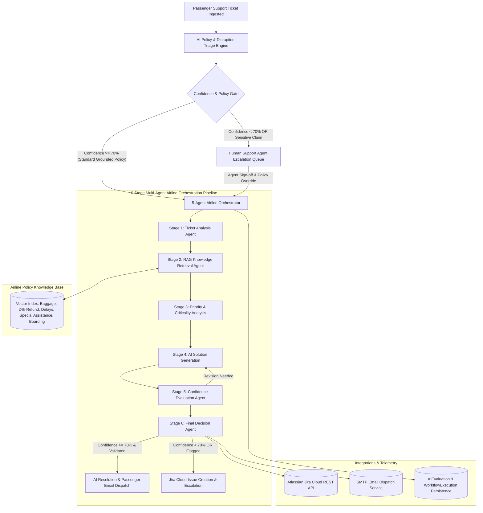

# AeroAssist AI — Intelligent Airline Passenger Support & Ticket Resolution Platform

AeroAssist AI is an enterprise customer-support and automated ticket-resolution platform tailored specifically for commercial airlines, ground operations, and airport passenger support teams.

It processes passenger inquiries, ingests booking PNRs and flight disruption cases, retrieves verified airline policy runbooks using semantic RAG vector retrieval, synthesizes grounded and empathetic passenger resolutions, and orchestrates an autonomous 5-agent pipeline with confidence-based human-in-the-loop escalation.

---

## 1. System Architecture



---

## 2. Core Functional Modules

### 1. Dedicated Public Welcome Page (`/welcome`)
- **Standalone Public Landing Page:** Separate from the authenticated operational dashboard.
- **Hero Section:** *"Smarter Airline Support. Faster Resolutions. Better Passenger Experiences."*
- **Action Buttons:** *Get Started* (directs to register/sign-in) and *Explore AI Features* (smooth-scrolls to live feature architecture).
- **Core Showcase:** Highlights intelligent ticket triage, knowledge-grounded AI assistance, the 5-agent resolution workflow, human oversight guardrails, and real-time AI performance monitoring.
- **Persona Quick-Starts:** 1-click evaluation access for Airline Admin, Support Agent, and Passenger roles.

### 2. Authenticated Operational Home Page (`/home`)
- **Executive Operations Dashboard:** Operational home distinct from the public landing page.
- **Headline:** *"Welcome to AeroAssist AI"* — Manage passenger support tickets, review AI-generated solutions, and monitor airline support operations.
- **Quick Actions:** Create New Ticket, Test AI Resolution, Run Multi-Agent Workflow, View AI Analytics, Manage Knowledge Base.
- **Summary KPI Cards:** Total Tickets, Open Tickets, AI Resolved, Escalated, Average Resolution Time, and AI Resolution Rate.
- **Interactive Visualizations:** 14-day ticket volume trend chart, resolution ratio breakdown (AI Resolved vs Escalated), and searchable recent tickets table.

### 3. Dedicated AI Performance Analytics Dashboard (`/analytics`)
- **Time Horizon Filters:** Today, Last 7 Days, Last 30 Days, Last 90 Days, All Time, and Custom Date Range picker. Category, Status, and Model filters.
- **8 Core AI Performance KPIs:**
  1. *Total AI Evaluations* (Total volume evaluated in selected time window).
  2. *Successful AI Resolutions* (Count and ratio of eligible automated solutions).
  3. *AI Resolution Rate* `(AI Resolved / Total Evaluated) × 100`.
  4. *Human Escalation Rate* `(Escalated / Total Evaluated) × 100`.
  5. *Average Confidence Score* (Arithmetic mean of model confidence; 70% threshold gate).
  6. *Average Pipeline Latency* (Mean duration in milliseconds from start to resolution).
  7. *Validation Pass Rate* `(Validation Pass Count / Total Validated) × 100`.
  8. *Ground-Truth Accuracy & AI Error Rate* (Verified against human supervisor feedback).
- **Confidence Distribution Histogram:** Visual distribution across 5 brackets: `0-29%`, `30-49%`, `50-69%`, `70-84%`, `85-100%`, with an interactive 70% threshold line and click-to-inspect ticket drawer.
- **AI Model Comparison Table:** Compares *AeroAssist-Agentic-v1* vs *Deterministic-Policy-Engine* on evaluations, resolution rate, confidence, validation rate, and latency.
- **5-Agent Performance Telemetry:** Granular duration and success statistics for Diagnosis, Retrieval, Resolution, Validation, and Escalation agents.
- **Evaluation History & CSV Export:** Searchable, paginated audit log of all AI evaluations with 1-click CSV download matching active filters.

### 4. AI Solution & Benchmark Testing Console (`/ai-solution`)
- **Two-Column Airline Console:**
  - *Left Panel:* Ticket selector, Passenger PNR dossier, flight number, travel date, category, and issue text.
  - *Right Panel:* Retrieved knowledge citations, AI-synthesized passenger communication with preview and edit mode, policy guardrail checklist, latency telemetry, and Approve/Escalate action buttons.
- **Benchmark Test Suite (High vs Low Confidence Cases):**
  1. *24-Hour Refund (Full Policy Supported):* High confidence (~92%), auto-resolvable.
  2. *Missing Baggage with No Runbook Match:* Low confidence (<40%), mandatory escalation.
  3. *Complex Connecting Flight Dispute:* Moderate confidence (~65%), station review advised.
  4. *Contradictory Passenger Claim:* Validation agent detects conflicting statements.
  5. *Incomplete Ticket (Missing PNR & Flight):* Low confidence, requests missing info.
  6. *Unsupported Guaranteed Compensation ($10,000):* Policy violation, flags non-compensable claim.
- **Human Ground-Truth Labeling Widget:** Evaluators can label AI responses as `Correct`, `Partially Correct`, `Incorrect`, or `Unable to Assess`, select a 1-5 star grounding rating, and save ground-truth telemetry directly to `evaluation_feedbacks`.

### 5. Dedicated 5-Agent Workflow Orchestrator (`/multi-agent-workflow`)
- **5 Cooperating Autonomous Agents:**
  1. **Diagnosis Agent:** Extracts passenger entities (PNR, Flight #, dates), diagnoses the primary inquiry category, and evaluates flight disruption urgency.
  2. **Retrieval Agent:** Queries the vector database for relevant airline runbooks and extracts ranked source passages with similarity scores.
  3. **Resolution Agent:** Synthesizes a courteous, empathetic, passenger-friendly response grounded strictly in airline policy citations.
  4. **Validation Agent:** Audits the generated response for factual correctness, detects unsupported commitments, and flags unauthorized financial compensation promises.
  5. **Escalation Agent:** Evaluates confidence against the 70% threshold, verifies validation clearance, and assigns the final ticket status (`RESOLVED` vs `NEEDS_REVIEW`).
- **Visual Pipeline:** Step-by-step progress tracker, status badges, start/completion timestamps, duration meters, and expandable inputs/outputs for each agent.

### 6. Airline Knowledge Base & Semantic RAG (`/knowledge-base`)
- **Verified Airline Policy Runbooks:**
  - `airline_cancellation_and_refund_procedure.md` (24h cooling off, non-refundable fares, DOT rules)
  - `airline_baggage_allowance_and_claims.md` (PIR filing, Montreal Convention SDR limits, delayed baggage)
  - `airline_flight_delay_and_disruption_assistance.md` (Tarmac delay rule, meal/hotel vouchers)
  - `airline_booking_and_reservation_policy.md` (Name corrections, schedule changes)
  - `airline_checkin_and_boarding_requirements.md` (Gate closing times, document verification)
  - `airline_seat_selection_and_upgrades.md` (Extra legroom, operational cabin upgrades)
  - `airline_special_assistance_procedure.md` (Wheelchair WCHR/WCHS/WCHC, service animals)
  - `airline_passenger_support_escalation_guide.md` (Station supervisor escalation protocols)
- **Document Management:** Upload PDF, TXT, DOCX, and Markdown files. Automatic chunking, vector embedding indexing, and semantic similarity search.

---

## 3. Demo User Personas & Credentials

| Role | Email | Password | Permissions |
| :--- | :--- | :--- | :--- |
| **Airline Operations Admin** | `admin@aeroassistant.com` | `AdminPass123!` | System settings, evaluation feedback, full ticket management |
| **Support Agent** | `engineer@aeroassistant.com` | `EngineerPass123!` | Ticket resolution, human review, reclassification, agent notes |
| **Passenger** | `passenger@aeroassistant.com` | `PassengerPass123!` | Ticket submission, status tracking, passenger portal |

---

## 4. Running the Application on Windows

### Prerequisites
- Python 3.11+
- Node.js 18+ and npm

### Terminal 1: Backend Server
```powershell
cd C:\Users\kolik\Downloads\pro\backend
.\venv\Scripts\Activate.ps1
python -m uvicorn app.main:app --reload --host 127.0.0.1 --port 8000
```
- **Backend API:** `http://127.0.0.1:8000`
- **Swagger Interactive API Documentation:** `http://127.0.0.1:8000/docs`

### Terminal 2: Frontend Client
```powershell
cd C:\Users\kolik\Downloads\pro\frontend
npm run dev
```
- **Frontend URL:** `http://localhost:5173/`
- **Welcome Page:** `http://localhost:5173/welcome`
- **Home Page:** `http://localhost:5173/home`
- **AI Analytics Dashboard:** `http://localhost:5173/analytics`
- **AI Solution Testing Console:** `http://localhost:5173/ai-solution`
- **Multi-Agent Workflow:** `http://localhost:5173/multi-agent-workflow`
- **Knowledge Base:** `http://localhost:5173/knowledge-base`

---

## 5. Automated Test Suite

Run the full backend test suite covering 28 unit and integration tests:

```powershell
cd C:\Users\kolik\Downloads\pro\backend
.\venv\Scripts\python.exe -m pytest tests/ -v
```
*(All 28 tests pass).*

Run the live end-to-end integration and telemetry test:
```powershell
cd C:\Users\kolik\Downloads\pro
.\backend\venv\Scripts\python.exe scripts/verify_airline_app.py
```
*(All 14 live verification checks pass, validating authentication, ticket ingestion, AI resolution, 5-agent pipeline, knowledge retrieval, analytics metrics, confidence distribution, feedback persistence, and CSV export).*

Compile frontend TypeScript and production bundle:
```powershell
cd C:\Users\kolik\Downloads\pro\frontend
npm run build
```
*(Exits with code 0).*

---

## 6. AI Provider Configuration

By default, the platform runs in high-performance local agentic mode (`AI_MOCK_MODE=True`) using deterministic airline policy matching, local embeddings, and rule-based guardrails.

To enable live external LLM generation:
1. Copy `.env.example` to `backend/.env`.
2. Configure your provider key:
   ```env
   AI_MOCK_MODE=False
   AI_PROVIDER=openai   # or anthropic / gemini
   OPENAI_API_KEY=your-api-key-here
   OPENAI_MODEL=gpt-4o-mini
   ```
3. Restart the backend server. The multi-agent workflow and AI solution console will automatically utilize the configured LLM while maintaining policy grounding and safety guardrails.
